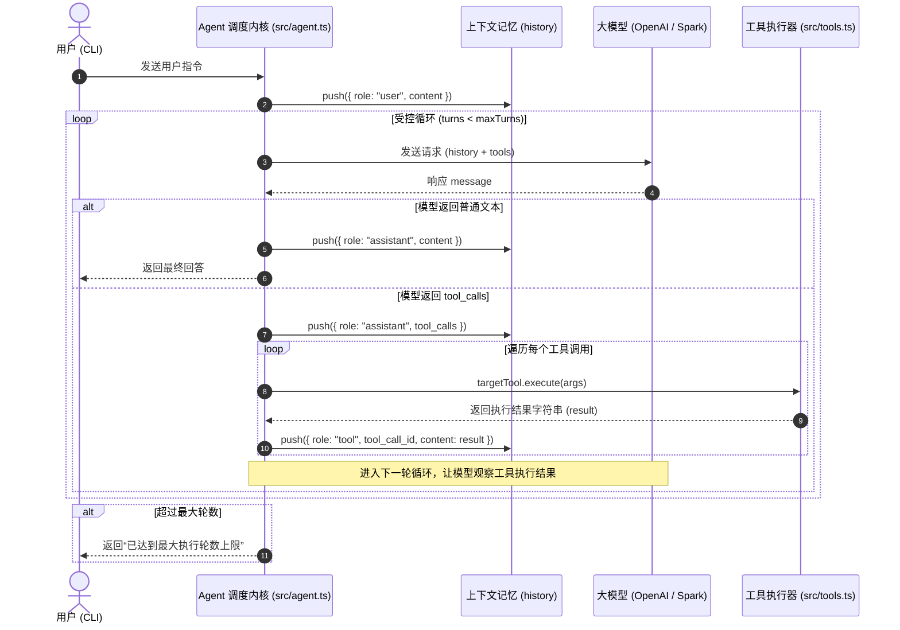

# 02 - Agent 受控循环与对话记忆

## 一、 核心设计理念

### 1. ReAct 范式（Reason + Act）
AI Agent 与普通聊天机器人的本质区别在于其**自主决策与行动闭环**。Agent 通过反复执行“思考（Reason） -> 行动（Act） -> 观察（Observe）”完成复杂目标：
1. **Reason**：大模型根据当前上下文决定是直接回复文本，还是调用一个或多个外部工具；
2. **Act**：调度系统在宿主环境中执行目标工具；
3. **Observe**：将执行结果伪装成观察值写回消息栈，大模型在下一轮中综合评估是否继续或总结。

### 2. 消息协议与严格对齐（Message Pairing）
OpenAI 规范要求：一旦大模型返回包含 `tool_calls` 的 `assistant` 消息，上下文历史中**必须立即紧跟对应数量的 `{ role: "tool", tool_call_id: id }` 消息**。任何漏填或乱序都会导致下游 API 报 400 格式错误。

### 3. 受控熔断（Turn Guard）
LLM 的输出具有不确定性，可能陷入无休止的循环调用（死循环）。必须显式设置 `maxTurns`（默认 5 轮），超过上限立即硬终止，杜绝 Token 耗尽和资源死锁。

---

## 二、 核心时序与状态流转

