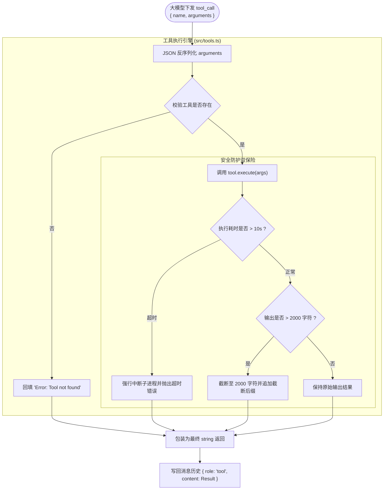

# 03 - 工具契约规范与沙箱安全防护

## 一、 核心设计理念

### 1. 契约化声明（JSON Schema 规范）
大模型不能直接执行代码，它只能“声明意图”。为了让模型精准生成参数，必须遵循标准的 JSON Schema 协议：
* **`type: "object"`**：定义顶层载荷为对象；
* **`properties`**：定义每个参数的键名、数据类型与语义说明；
* **`required`**：声明必填字段，约束模型不得遗漏关键参数。

在 [src/types.ts](file:///c:/Users/29784/Desktop/ycc/src/types.ts) 中，我们将工具抽象为高内聚的 `Tool` 契约：
```ts
export interface Tool {
  name: string;
  description: string;
  parameters?: Record<string, unknown>;
  execute: (args: Record<string, unknown>) => Promise<string> | string;
}
```

### 2. 沙箱安全双保险（Double-Fuse Protection）
本地执行命令行工具（如 `run_command`）具有极高风险，极易发生**进程挂起死锁**与**输出过长导致 Token 爆炸**。我们建立了工业级的双重熔断机制：
1. **10 秒执行超时熔断**：任何长时间未退出的子进程（如死循环、等待用户输入的交互命令）将在 10 秒后被强行杀死，释放系统句柄；
2. **2000 字符强截断保护**：当命令输出超过 2000 字符时，自动截断多余字符并追加 `...[输出过长已截断]` 提示，防止由于单次执行输出几万行日志而击穿大模型上下文窗口。

---

## 二、 工具执行安全管道架构图


