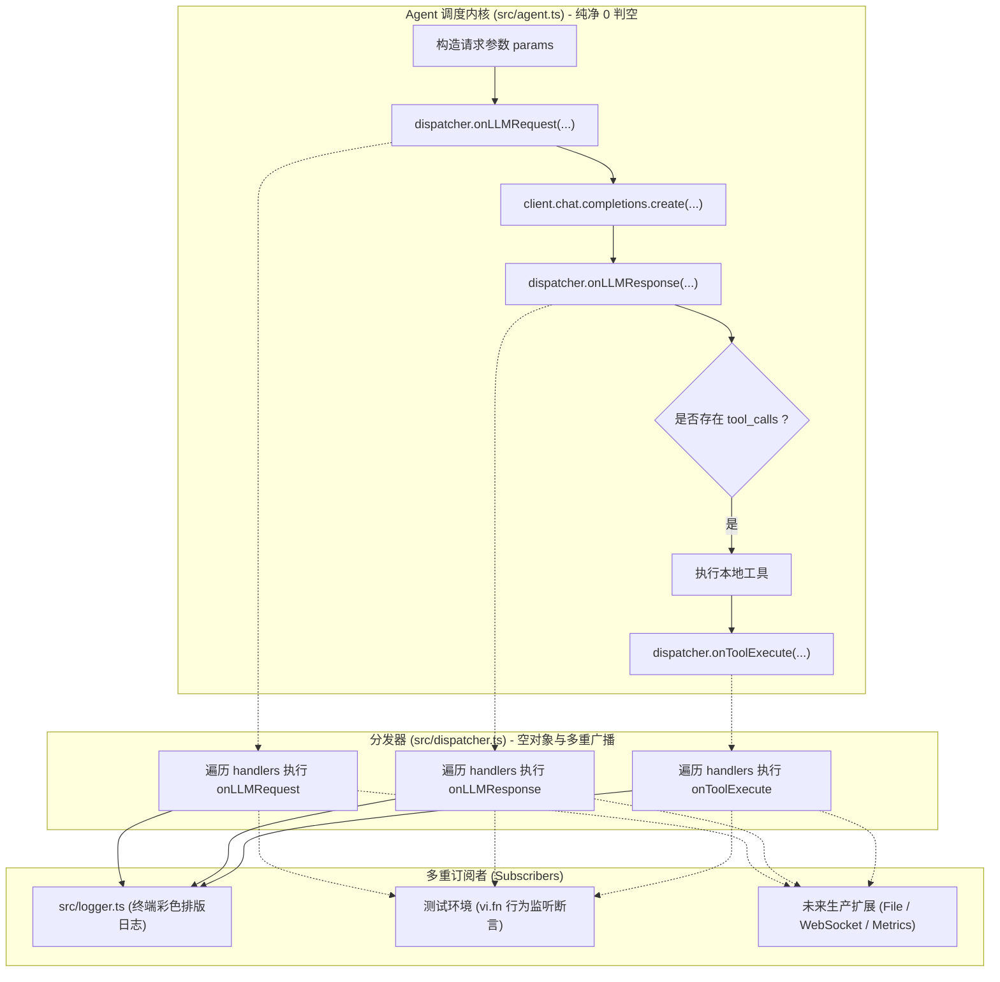

# 04 - 生命周期 Hook 管道与分发器模式

## 一、 核心设计理念

### 1. 控制反转（IoC）与纯净内核（Pure Kernel）
在初版设计中，打印逻辑通过 `if (verbose) console.log(...)` 散落在内核各处。这导致：
* 核心算法与终端 I/O 副作用死死绑定；
* 无法为单元测试、Web UI 或生产监控定制不同的输出呈现。

通过引入生命周期 Hook 管道，内核只负责在状态流转的关键节点“派发事件”，彻底删除了所有 `console.log` 和条件分支，实现了 100% 纯净内核。

### 2. Hook 的 4 阶演进谱系
| 阶段 | 类型 | 签名特征 | 权利范围 | 典型应用场景 |
| :--- | :--- | :--- | :--- | :--- |
| **Level 1** | **监听型（Tap）** | `() => void` | **只看不动**（当前阶段） | 终端彩色打印、Prometheus 打点、文件归档 |
| **Level 2** | **变形型（Transform）** | `(data) => data` | **加工修改数据** | 发请求前敏感词脱敏、工具结果提炼压缩 |
| **Level 3** | **守卫型（Guard）** | `() => boolean` | **一票否决权** | 人机交互确认（如阻止高危 `rm -rf` 指令） |
| **Level 4** | **洋葱型（Around）** | `(ctx, next) => void` | **流程包裹控制** | 大模型调用超时自动重试、备用模型无缝降级 |

### 3. 空对象模式（Null Object Pattern）与 0 `if` 盲调
传统的做法是在每次调用 Hook 时做防御判断：`if (hooks && hooks.onLLMRequest) ...`。
我们在 [src/dispatcher.ts](file:///c:/Users/29784/Desktop/ycc/src/dispatcher.ts) 中引入了行业标杆（LangChain `CallbackManager`）的分发器模式：
* 无论外界是否传入 Hook，分发器内部统一维护 `handlers: AgentHooks[]`（未传时为空数组）；
* 内核直接执行 `dispatcher.onLLMRequest(...)`，0 个 `if` 条件分支；
* 天然支持**多重监听广播（Multicast）**：支持传入 `hooks: [consoleLogger, fileLogger]`，分发器顺序广播。

---

## 二、 生命周期 Hook 管道架构图

