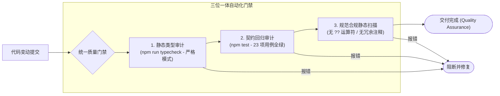

# 05 - 编码规范约束与质量门禁

## 一、 核心设计理念

### 1. 零解释性注释法则（Self-Explaining Code）
* **规则**：严禁在常规业务逻辑中添加“这段代码在做什么”的解释性注释；
* **思想**：注释是对糟糕命名的掩饰。良好的类型契约、清晰的变量命名与单一职责函数本身就是最好的文档。代码变动时注释容易失真过时，而自解释代码永远真实。

### 2. 禁止使用 `??` 运算符做隐式兜底
* **规则**：严禁使用空值合并运算符（`??`）为潜在的 `undefined` 或 `null` 做静默兜底；
* **思想**：隐式兜底常常会吞掉上游的真实逻辑缺陷（例如拼错字段名、未配置环境变量、缺失必填参数）。所有缺失值与异常必须通过**显式前置校验**、**类型守卫**或**显式抛错**解决。

### 3. 测试为安全绳（Regression Guard）
* **规则**：任何业务重构或功能增减，必须同步联动编写或调整单元测试；
* **思想**：测试是敢于大刀阔斧重构代码的唯一底气。当前系统维护 4 个测试套件，共计 23 个测试用例，涵盖基础问答、多轮记忆、工具调度、错误回填、轮次熔断、Hook 触发与多重广播，每次变更必须 100% 变绿通过。

---

## 二、 自动化质量门禁流水线

| 门禁维度 | 检验工具与命令 | 成功基准 | 违规后果 |
| :--- | :--- | :--- | :--- |
| **类型安全** | `npm run typecheck` (`tsc --noEmit`) | 0 Errors | 严禁类型逃逸，直接阻断构建 |
| **行为契约** | `npm test` (`vitest run`) | 23/23 用例 100% Passed | 拒绝功能退化，必须修复至全绿 |
| **规范合规** | `git grep -n "??"` & `git grep -n "//"` | 匹配结果计数均为 0 | 违规立即修正，保持代码纯净 |
