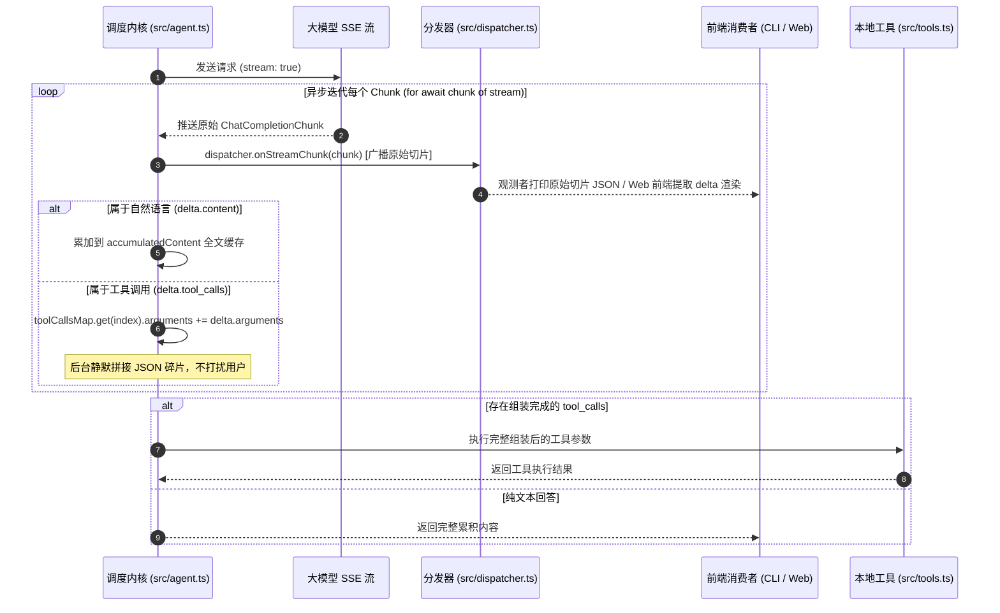

# 06 - 流式传输与数据碎片组装

## 一、 核心设计理念

### 1. 交付形态的转变：从整包到流式（Streaming Paradigm）
在非流式模式下，大模型推理计算必须全部完成后才通过单次 HTTP 响应返回。这在长文本生成或复杂任务中会导致客户端长时间阻塞等待。
在流式模式下（`stream: true`），服务端通过 Server-Sent Events（SSE）以数据片（`ChatCompletionChunk`）的形式，每生成一个 Token 即时推送。

### 2. 原始切片广播与双轨制处理（Raw Chunk & Dual-Track Processing）
流式传输推送的数据片携带了丰富的元信息，调度内核采取“原始切片即刻派发 + 内部双轨处理”策略：
1. **原始切片广播（Raw Chunk Broadcast）**：
   * 每一个从网络到达的 `ChatCompletionChunk`，不做任何截断或阉割，第一时间直接触发 `dispatcher.onStreamChunk(chunk)`，让可观测监听器（如终端日志、调试器）能够无损看到最原始的报文切片。
2. **自然语言文本（Text Tokens）**：
   * 若切片包含 `delta.content`，内核累加到完整文本缓存中，用于构建历史和最终返回。
3. **工具调用碎片（Tool Call Chunks）**：
   * 若切片包含 `delta.tool_calls`，内核在后台通过 `toolCallsMap` 按 `index` 静默拼接 `id`、`name` 与 `arguments` 字符串，直至流结束拼装成完整的可反序列化对象。

### 3. 多前端共用机制（Decoupled Consumption）
内核不绑定任何具体的 UI 呈现逻辑。无论是 CLI 终端的 `process.stdout.write`，还是 Web 端的 HTTP SSE 推流、小程序的 WebSocket，都只需订阅 `onStreamChunk` 即可完成实时渲染。

---

## 二、 流式数据流转与碎片组装架构图

