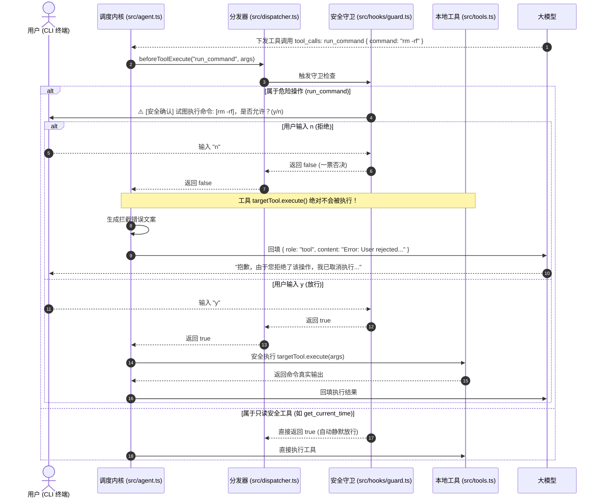

# 07 - 人机交互安全守卫与拦截型 Hook

## 一、 核心设计理念

### 1. 人机协同安全防线（Human-in-the-Loop, HITL）
在 Agent 获得执行本地终端命令（`run_command`）等高危能力后，由于大模型输出的不确定性，完全放任其自主执行存在极高的生产风险（如意外删除重要文件、修改系统环境配置）。
必须建立一道不可逾越的人机协同确认防线：**在危险工具真正落地执行前，挂起执行流并向用户索取授权。**

### 2. Level 3 守卫型 Hook（Guard Hook 与一票否决权）
我们将 Hook 从 Level 1（只看不动的通知型）正式升级出 **Level 3（守卫型）**：
* 契约方法：`beforeToolExecute?: (name: string, args: Record<string, unknown>) => Promise<boolean> | boolean`
* **短路拦截机制（Short-Circuit）**：
  分发器（`HookDispatcher`）串行遍历已注册的守卫，只要有**任何一个守卫返回 `false`**，立刻短路中断，不再调用后续守卫，也绝不调用 `targetTool.execute()`。
* **错误回填自愈（Self-Healing via Rejection Feedback）**：
  当操作被拦截后，内核向消息栈注入 `{ role: "tool", content: "Error: User or security guard rejected execution..." }`。大模型在下一轮感知到用户拒绝后，会自动解释意图或转换方案，而不是直接系统崩溃。

### 3. 微内核与插件物理分层（Microkernel & Hooks Directory）
将外围扩展从 `src/` 根目录收敛为 `src/hooks/` 独立插件专区：
* `src/hooks/logger.ts`：纯粹负责排版与可观测性（看）；
* `src/hooks/guard.ts`：纯粹负责权限判定与终端人机确认（拦）；
* `src/hooks/index.ts`：统一暴露出口；
* 内核调度引擎（`agent.ts`, `dispatcher.ts`）与插件实现彻底物理隔离。

---

## 二、 人机交互安全拦截时序图

