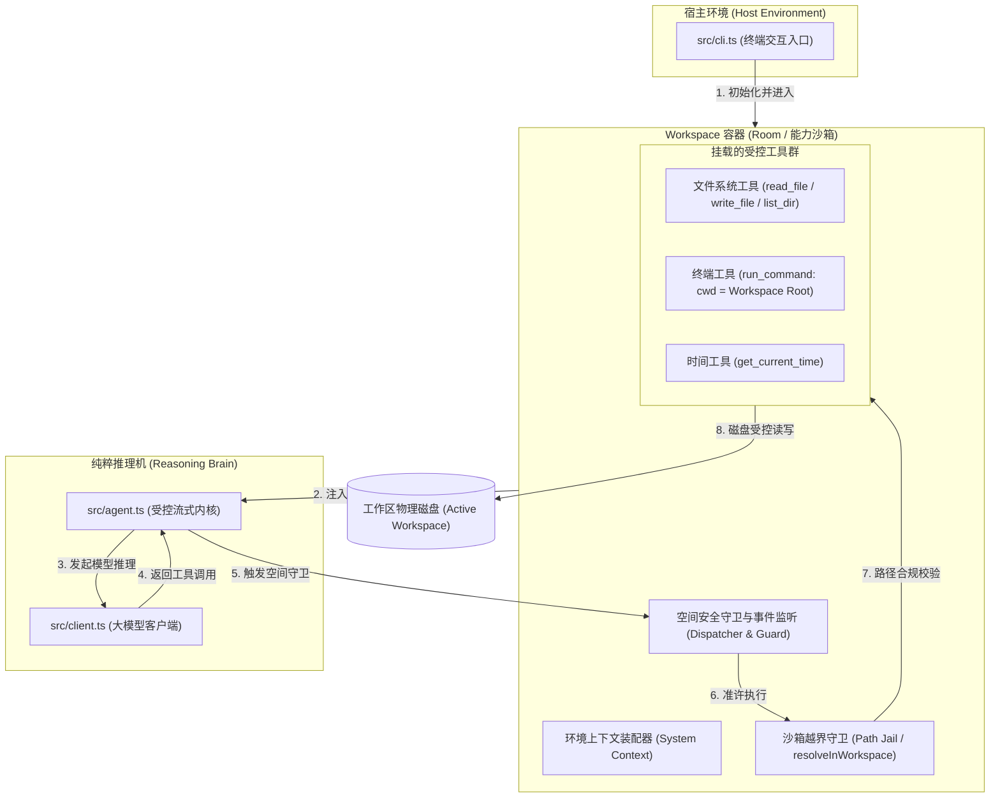
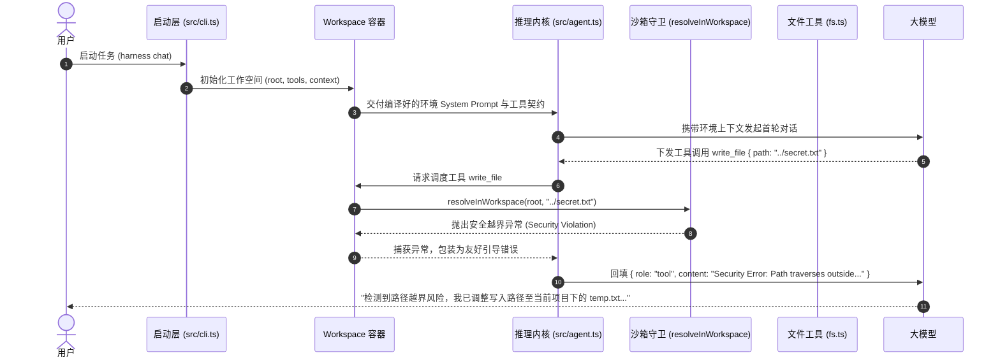

# 08 - Workspace 容器、沙箱隔离与环境上下文架构

## 一、 核心设计哲学与范式重构

在 Agent 演进至具备直接操作系统与文件能力的阶段，传统的“Agent 挂载工具并在任意路径执行”的模式暴露出了严重的架构缺陷：
* 工具脱缰：路径无约束，极易引发越权读取与跨目录修改（Path Traversal）；
* 上下文失忆：大模型不感知自身操作系统、工作区根路径与运行约束，全靠猜测；
* 认知发散：缺少明确的注意力边界，海量无关信息混入 Prompt 造成幻觉。

为此，系统引入 **控制反转（Inversion of Control, IoC）** 理念，对工作空间、沙箱与上下文进行深度的三位一体解构。

```
┌─────────────────────────────────────────────────────────────┐
│                    Workspace (空间容器 / 房间)               │
│                                                             │
│   ┌─────────────────────────────────────────────────────┐   │
│   │         Environment Context (环境感知上下文)          │   │
│   │  • System Info (OS, Time)   • Workspace Root Path   │   │
│   │  • System Prompt (Role, Constraints & Rules)        │   │
│   └──────────────────────────┬──────────────────────────┘   │
│                              ▼                              │
│   ┌─────────────────────────────────────────────────────┐   │
│   │            Sandbox Boundary (沙箱隔离墙)             │   │
│   │  • resolveInWorkspace: 严禁跨越 Workspace 根目录    │   │
│   │  • Path Traversal Defense (越界即拦截并自愈引导)     │   │
│   └──────────────────────────┬──────────────────────────┘   │
│                              ▼                              │
│   ┌─────────────────────────────────────────────────────┐   │
│   │             Mounted Tools (空间受控道具)             │   │
│   │  • read_file / write_file / list_directory (受限)   │   │
│   │  • run_command (锁定工作目录为 Workspace Root)       │   │
│   └─────────────────────────────────────────────────────┘   │
└─────────────────────────────────────────────────────────────┘
```

### 1. 控制反转（IoC）与 MUD 房间范式（Room Paradigm）
* **传统模式（Agent 挂载工具）**：Agent 是主体，身上挂满各种工具，外部丢给它一个 `cwd` 让其操作。这导致 Agent 过于臃肿，安全边界不可控。
* **新范式（Workspace 是能力容器）**：Agent 被降级为一个纯粹、无状态的推理引擎（Reasoning Brain）。**Workspace 升格为一个“房间（Room）”**：
  * 房间定义了物理墙壁（沙箱路径与越界保护）；
  * 房间陈列了特定道具（挂载在空间上的受控工具集）；
  * 房间设定了世界观与规则（动态注入的系统提示词与环境上下文）；
  * 房间设置了安全机关与守卫（Hooks 与 Dispatcher）。
  * Agent 只是走入房间、在规则约束下行动的访客。

### 2. 黑板模式（Stigmergy & Blackboard Pattern）
在现代 Agent 体系中，文件系统不仅仅是磁盘持久化，更是 **“环境即通信总线（The environment is the message bus）”**。
* Agent 与环境交互、多轮思维演进以及多 Agent 协同，均通过向房间的“黑板”（工作区内的 Markdown/源码/文档）写入状态与读取反馈来完成。
* 彻底摆脱纯靠 Prompt 堆砌海量长 JSON 消息的低效模式，大幅节省 Token 并提高长上下文稳定性。

### 3. 限界上下文（Bounded Context）
借鉴领域驱动设计（DDD），Workspace 是严格的限界上下文：
* Agent 进入空间时，注意力被强行收敛到空间根目录与其绑定的特定工具上；
* 屏蔽无关干扰，从根源上斩断大模型的注意力漂移与幻觉。

---

## 二、 核心契约与沙箱规范

### 1. Workspace 抽象契约
```ts
export interface Workspace {
  root: string;                       // 空间物理边界与沙箱基准
  tools: Tool[];                      // 空间受控道具集合
  systemPrompt: string;               // 空间世界观与环境感知提示词
  hooks?: WorkspaceHooks | WorkspaceHooks[];  // 空间机关、安全门禁与监控探针
  maxTurns?: number;                  // 空间行动步数配额 (默认 5)
}
```
* **消除中间层**：彻底拔除历史上的 `ChatOptions` 接口，调用签名演进为直接接收 `workspace?: Workspace`，所有能力、规则与配额 100% 收敛于 Workspace 容器内。

### 2. 沙箱防越界算法（Path Traversal Guard）
任何文件操作在触碰操作系统底层之前，必须经由沙箱路径解析器进行合规校验：
```ts
export function resolveInWorkspace(workspaceRoot: string, targetPath: string): string {
  const resolvedRoot = path.resolve(workspaceRoot);
  const resolvedTarget = path.resolve(resolvedRoot, targetPath);
  const relative = path.relative(resolvedRoot, resolvedTarget);

  if (relative.startsWith("..") || path.isAbsolute(relative)) {
    throw new Error(`Security Violation: Path "${targetPath}" escapes workspace boundary`);
  }

  return resolvedTarget;
}
```
* **自愈型错误反馈**：一旦触发越界，沙箱将违规拦截，并生成明确的引导性错误（`Security Error: Access denied. Path traverses outside workspace boundary.`），促使大模型在下一轮推理中自我修正路径。

### 3. 环境上下文装配（Context Assembler）
在 Agent 执行首轮推理前，系统将 Workspace 的物理状态编译为标准的第一条 `system` 消息：
```text
[系统环境与安全规范]
- 当前操作系统: win32
- 授权工作空间根目录: c:\Users\...\project
- 安全规则: 严禁尝试访问或修改工作空间之外的任何系统文件；优先在工作空间内完成分析与输出。
```

### 4. 智能项目根探测与家目录天花板保护 (Project Root Discovery & Ceiling Guard)
若直接依赖 `process.cwd()` 作为工作空间根目录，当开发者在深度嵌套子目录中启动 Agent 时，沙箱边界会被缩减在子目录内，无法触及项目根部的关键配置文件。
系统在 `createWorkspace` 默认入口引入向上回溯算法 `findProjectRoot(startDir)`：
* **向上探索标志**：逐级向上遍历祖先目录，寻找 `.git` 目录或 `package.json` 项目清单。
* **家目录安全天花板 (Home Ceiling Guard)**：当向上回溯到达用户家目录（`os.homedir()`）且起始目录并非家目录时，强制截断并停止向上逃逸，防止用户家目录存在残留配置文件时意外将整个个人根目录作为工作空间。
* **优雅退化**：遍历至文件系统顶层仍未命中时，安全退回给定的起始目录。

---

## 三、 架构拓扑与交互时序图

### 1. 架构拓扑图



### 2. 交互时序图



---

## 四、 演进路线与加尔定律落地

遵循加尔定律（Gall's Law），Workspace 的落地分为清晰的递进阶段：

| 阶段 | 范式成熟度 | 核心特征 |
| :--- | :--- | :--- |
| **阶段 11 (当前)** | **本地受控单空间** | 确立极简 `Workspace` 抽象与沙箱边界，挂载第一套原生沙箱文件工具（`read_file`, `write_file`, `list_directory`），实现绝对路径防逃逸。 |
| **阶段 12** | **非侵入式项目映射** | 引入 `~/.harness/workspaces/<hash>`，存储跨会话历史快照、审计记录与暂存草稿纸（Scratchpad），彻底实现零污染。 |
| **阶段 13** | **Git Worktree 瞬态微沙箱** | 执行破坏性编码任务时，在底层自动创建独立的 Git Worktree 分支，全绿测试后原子合入。 |
| **阶段 14** | **MCP 联邦总线与多智能体** | 支持外部 MCP 工具服务器热插拔，多 Agent 基于空间黑板进行非即时协同。 |
