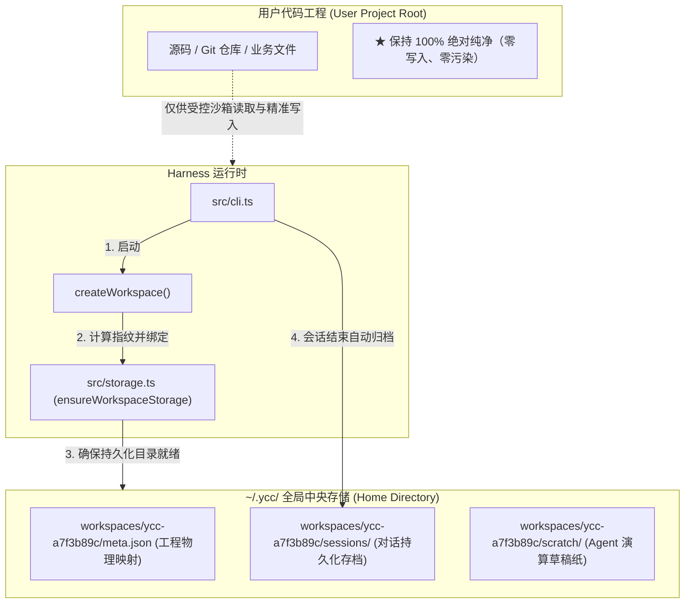
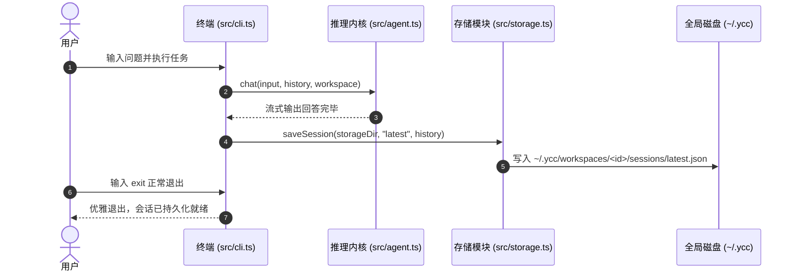

# 09 - 非侵入式项目全局持久化与工作区映射架构

## 一、 核心设计哲学：代码库零污染（No Dotfile Littering）

在传统开发工具中，生成本地元数据目录（如 `.git/`、`.vscode/`、`.gemini/`）是常见的做法。然而，在以自主智能体（Autonomous Agent）为代表的高频交互与跨项目演进场景中，**直接在用户项目根目录写入点号配置文件（Dotfiles）会带来严重的工程痛点**：
* **污染代码仓库**：每次启动 Agent 都会导致用户的 `git status` 出现新增未跟踪文件，极易被意外提交到远程仓库；
* **配置碎片化**：不同机器、不同工作区如果分散保存元数据，难以形成统一的全局治理视图；
* **敏感信息风险**：对话历史或中间审计日志若落在代码库内，存在随 Git 仓库泄漏的风险。

为此，Harness 坚决贯彻 **方案 B（全局零污染架构）**：
用户的代码工程目录保持绝对的神圣纯净，所有的跨会话记忆、审计元数据、草稿演练空间，统一收敛至操作系统用户家目录下的 **`~/.ycc/`**。

---

## 二、 存储拓扑与路径指纹算法

### 1. 存储目录树结构

```text
~/.ycc/                                         # 系统全局中央存储根目录
├── config.json                                 # 全局首选项（模型配置、默认配额等）
└── workspaces/                                 # 项目专属映射抽屉总库
    └── <slug>-<hash>/                          # 各工程基于路径指纹的唯一隔离抽屉
        ├── meta.json                           # 项目元数据（物理根路径、初建时间、访问时间）
        ├── sessions/                           # 跨会话对话记忆持久化
        │   ├── latest.json                     # 最近一轮完整会话
        │   └── session-<id>.json               # 历史命名的快照
        └── scratch/                            # Agent 私人演算草稿区（临时分析脚本、中间产物）
```

### 2. 路径指纹算法（Path Fingerprinting）
为了实现“无需用户配置，任意项目开箱即用”并确保跨平台稳定性：
1. **绝对路径规格化**：通过 `path.resolve` 规范化物理工程根目录；
2. **大小写不敏感哈希**：在 Windows 和 macOS 上文件系统不区分大小写，算法将规范化路径统一转换为小写后进行 SHA-256 计算，截取前 8 位 Hex 字符串；
3. **人类可读工程 Slug**：提取项目最末级目录名（如 `ycc`），过滤非安全字符并拼装哈希，生成形式如 `ycc-a7f3b89c` 的目录名。

```ts
export function getProjectFingerprint(projectPath: string): {
  slug: string;
  hash: string;
  id: string;
}
```

---

## 三、 核心契约与生命周期

### 1. Workspace 契约升级（src/types.ts）
工作空间容器对象扩充了 `storageDir` 属性，指向该工程在 `~/.ycc/workspaces/` 中的物理抽屉：

```ts
export interface Workspace {
  root: string;                               // 物理工程根目录（代码受控沙箱）
  storageDir?: string;                        // 专属全局持久化目录 (~/.ycc/workspaces/<id>)
  tools: Tool[];                              // 空间受控工具集合
  systemPrompt: string;                       // 空间环境规则与系统提示词
  hooks?: WorkspaceHooks | WorkspaceHooks[];  // 空间安全门禁与事件监听
  maxTurns?: number;                          // 最大行动步数配额
}
```

### 2. 会话持久化与恢复（Session Storage API）
[src/storage.ts](file:///c:/Users/29784/Desktop/ycc/src/storage.ts) 提供了纯净且健壮的异步持久化 API：
* `saveSession(storageDir, sessionId, history)`：原子化保存对话历史，记录更新时间戳；
* `loadSession(storageDir, sessionId)`：加载历史会话，若不存在则优雅返回 `null`；
* `listSessions(storageDir)`：检索该工程专属抽屉下的所有历史会话列表。

### 3. 全局配置中心与纯粹单一数据源（Global Config as Single Source of Truth）
系统全面走用户目录下的配置文件 `~/.ycc/config.json` 作为唯一信任源，不再判断或回退任何 `process.env`（`OPENAI_API_KEY`、`OPENAI_BASE_URL`、`OPENAI_MODEL`），彻底杜绝环境污染与配置飘移：
* `loadGlobalConfig()` / `saveGlobalConfig(config)`：原子化读取与保存全局中央配置；
* `resolveAppConfig()`：直接读取并规格化 `~/.ycc/config.json` 中的配置（自动清洗 `baseURL` 多余后缀），为推理引擎与客户端提供确定性的凭证输入；
* 所有工程无需任何本地点号文件，亦无需在系统环境中反复配置全局环境变量，一次 `ycc init`，全局永久生效。

### 4. 交互式配置向导与自举自愈（Init Wizard & Self-Bootstrapping）
* **`ycc init` 交互向导**：提供类似 `npm init` 的交互式提问（API Key、Base URL、Model），显示当前配置值作为默认值，支持直接回车保留或输入新值强制覆盖保存至 `~/.ycc/config.json`；
* **`ycc up` / `ycc run` 自动预检**：启动时执行 `ensureGlobalStorage()` 自检基础设施；若检测到未配置 API Key，终端自动无缝切入向导，配置完成后**直接原地继续启动工作空间**，无需二次执行命令。

---

## 四、 架构拓扑与交互时序图

### 1. 全景存储拓扑图



### 2. 会话归档时序图



---

## 五、 质量与演进里程碑

| 维度 | 指标与达标状态 |
| :--- | :--- |
| **测试套件** | 9 个测试套件，71 个契约用例 100% 变绿通过 |
| **类型安全** | `tsc --noEmit` 严格类型检查 0 错误 |
| **代码规范** | 全代码库维持 0 注释，0 `??` 或 `??=` 运算符 |
| **二进制打包** | 配置 `bin: { ycc: "./dist/main.js" }`，支持全局 `ycc [up|run|init]` |
| **环境隔离** | 单元测试通过 `vi.spyOn(os, "homedir")` 在临时沙箱中运行，生产代码不掺杂任何环境变量，绝对不污染开发机物理主目录 |
