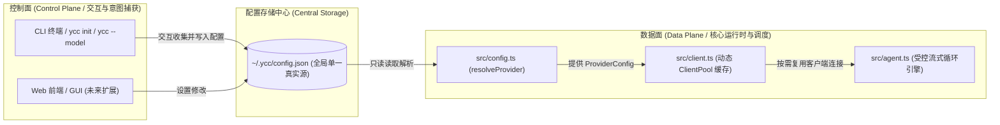

# 10 - 多模型服务商架构与控制面解耦

## 一、 核心设计哲学：控制面与数据面彻底分离

在以自主智能体（Autonomous Agent）为核心的应用系统中，随着业务复杂度增加，开发者通常需要随时切换不同模型厂商（如 Spark、DeepSeek、OpenAI、Claude、Ollama 等）。如果配置系统仅支持单模型单凭证，将导致切换服务商时不断破坏旧配置。

参考业界标杆设计：
* **OpenClaw**（`~/.openclaw/openclaw.json`）：采用多服务商配置字典与全局活跃模型指针解耦；
* **Claude Code**：通过 CLI 终端命令交互（`/model`、`--model <name>`）收集用户意图并落盘，核心调度引擎纯粹消费配置；
* **Codex / Aider**：采用参数优先级链与动态客户端池化路由。

Harness 确立了**控制面与数据面分离（Control Plane vs Data Plane Decoupling）**的架构范式：



* **控制面（Control Plane）**：负责交互收集（终端问答、命令行参数 `--model`、未来的 Web 界面配置弹窗），其产物是干净合法的结构化 JSON，写入中央配置文件 `~/.ycc/config.json`；
* **数据面（Data Plane）**：核心调度引擎（`src/agent.ts`、`src/client.ts`）纯粹是“配置消费者”，无需理解终端问答和 CLI 逻辑，严格依据解析规则加载凭证并执行。

---

## 二、 配置文件拓扑与规范（~/.ycc/config.json）

中央配置文件采用统一的 **`current` 活跃指针 + `providers` 字典** 结构：

```json
{
  "current": "spark",
  "providers": {
    "spark": {
      "baseURL": "https://maas-api.cn-huabei-1.xf-yun.com/v2",
      "apiKey": "ak-xxxxxxxxxxxxxxxx",
      "model": "spark-x2.6"
    },
    "deepseek": {
      "baseURL": "https://api.deepseek.com/v1",
      "apiKey": "sk-yyyyyyyyyyyyyyyy",
      "model": "deepseek-chat"
    }
  }
}
```

### 契约定义（src/types.ts）

```ts
export interface ProviderConfig {
  apiKey: string;
  baseURL: string;
  model: string;
}

export interface GlobalConfig {
  current?: string;
  providers?: Record<string, ProviderConfig>;
}
```

---

## 三、 模型解析与优先级路由策略

在执行单轮或多轮对话时，系统支持不同颗粒度的服务商覆写。优先级从高到低严格如下：

```text
调用级 targetModel (如 CLI 的 -m / --model 选项)
       ↓ (若未提供)
空间级 workspace.model (特定工程绑定的服务商)
       ↓ (若未提供)
全局当前指针 config.current (如 "spark")
       ↓ (若未配置)
默认兜底键 "default"
```

### 1. 严格校验与错误自愈引导
如果目标服务商未在 `providers` 中定义，或关键字段（`baseURL`、`apiKey`、`model`）缺失，系统绝不隐式降级，而是立即抛出清晰的错误指引：
```text
未找到服务商配置 "xxx"，请先在 ~/.ycc/config.json 中配置该服务商或运行 ycc init
缺少模型配置：当前服务商未配置 model 参数，请检查 ~/.ycc/config.json
```

### 2. BaseURL 自动化规范化
为了杜绝用户输入末尾多余斜杠导致的 404，`normalizeBaseURL` 函数会自动去除多余的尾部斜杠：
```ts
export function normalizeBaseURL(url: string): string {
  return url.replace(/\/+$/, "");
}
```

---

## 四、 动态客户端连接池（Client Pool）

为了兼顾灵活切换多服务商与高频调用的性能开销，`src/client.ts` 摒弃了单一全局单例，引入了**连接池（Connection Pool）**模式：

```ts
const clientPool = new Map<string, OpenAI>();

export function getClientForProvider(baseURL: string, apiKey: string): OpenAI {
  const cleanUrl = normalizeBaseURL(baseURL);
  const cacheKey = `${cleanUrl}::${apiKey}`;
  const cached = clientPool.get(cacheKey);
  if (cached) {
    return cached;
  }
  const client = new OpenAI({ baseURL: cleanUrl, apiKey });
  clientPool.set(cacheKey, client);
  return client;
}
```

* **连接复用**：同一个服务商（相同 BaseURL 与 APIKey）共享同一个 `OpenAI` 客户端实例，充分利用底层的 HTTP Keep-Alive 连接池；
* **按需创建**：在多 Agent 协同或跨模型对比场景下，不同服务商的客户端按需懒加载并缓存；
* **测试隔离**：提供 `resetClient()` 函数，在测试开始前可瞬间清空缓存池。

---

## 五、 零兼容、无垫片的纯粹演进

遵循 Gall's Law 与项目工程规范：
1. **不保留向下兼容垫片（Zero Backward-Compatibility Shims）**：坚决不保留过时的 `resolveAppConfig` 平铺字段读取，不为旧版单模型配置文件编写过渡兼容层；
2. **严禁隐式空值合并**：所有字段判空与缺失检查采用显式 `if`，严禁使用 `??` 操作符隐瞒配置缺失；
3. **自解释代码**：生产代码与测试代码 0 注释，依靠纯净的类型契约与严密的单元测试（75+ 测试用例 100% 覆盖）保障长期稳定性。
