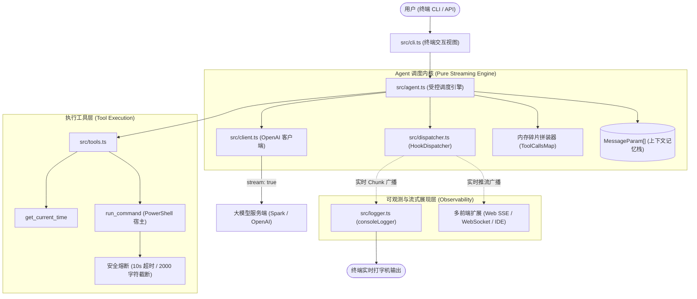

# Harness Agent 知识库与架构设计文档

本目录记录 Harness Agent 项目在演进过程中沉淀的核心**设计理念、架构模式与工程规范**。文档随系统自然生长，作为后续扩展与团队协作的技术基石。

---

## 知识库索引与模块导航

| 序号 | 文档名称 | 核心知识点与设计范式 |
| :--- | :--- | :--- |
| **01** | [加尔定律与系统自然生长法则](./01-philosophy-evolution.md) | 复杂系统演进哲学、反过早设计、5 阶段自然生长模型 |
| **02** | [Agent 受控循环与对话记忆](./02-agent-loop-memory.md) | ReAct 工具调用循环、上下文记忆栈、最大轮次熔断保护 |
| **03** | [工具契约规范与沙箱安全防护](./03-tool-contract-security.md) | JSON Schema 工具标准、PowerShell 执行器、超时与截断双保险 |
| **04** | [生命周期 Hook 管道与分发器模式](./04-lifecycle-hooks-dispatcher.md) | 控制反转（IoC）、空对象模式（Null Object）、多重广播、内核纯净化 |
| **05** | [编码规范约束与质量门禁](./05-code-quality-testing.md) | 零注释自解释原则、严禁 `??` 隐式兜底、三位一体自动化门禁 |
| **06** | [流式传输与数据碎片组装](./06-streaming-chunk-assembly.md) | Server-Sent Events 流式迭代、文本打字机与工具 JSON 碎片双轨处理、多端解耦 |

---

## 系统全景架构图

